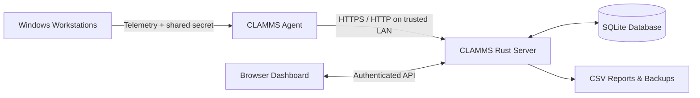

<div align="center">


# CLAMMS
### Computer Laboratory Asset & Maintenance Management System

**Know your equipment. Stay ahead of maintenance. Keep every lab running.**

[](https://github.com/projectbaluga/CLAMMS/actions/workflows/clamms.yml)
[](https://www.rust-lang.org/)
[](https://github.com/tokio-rs/axum)
[](https://www.sqlite.org/)
[](https://github.com/projectbaluga/CLAMMS)

[Explore the code](https://github.com/projectbaluga/CLAMMS) · [Report a bug](https://github.com/projectbaluga/CLAMMS/issues)

</div>

---

## 🚀 One place for your entire computer laboratory

CLAMMS brings laboratory inventory, equipment health, maintenance activity, and accountability into one focused dashboard. Its lightweight Rust server manages the records while an optional Windows agent periodically reports workstation telemetry.

Built for practical day-to-day laboratory operations, with role-based access and a local SQLite database.

## ✨ What it can do

| Capability | What you get |
|---|---|
| 🖥️ **Asset inventory** | Track asset tags, equipment details, status, serial numbers, hostnames, and related laboratory information |
| 🧪 **Laboratory registry** | Organize equipment by laboratory, room, or location |
| 🛠️ **Maintenance tracking** | Record reported issues, actions taken, and maintenance status |
| 📡 **Workstation monitoring** | Receive periodic CPU, memory, disk, OS, hostname, and uptime telemetry from enrolled Windows workstations |
| 👥 **Role-based access** | Separate administrator, custodian, and viewer permissions; maintenance actions are role-controlled |
| 🧾 **Audit trail** | Review administrative activity and recorded changes |
| 📊 **CSV reports** | Export asset and maintenance records for analysis |
| 💾 **Database backup** | Download a consistent SQLite backup and use the included PowerShell backup/restore tools |
| 🔐 **Safer authentication** | Password hashing, expiring bearer sessions, and a shared secret for agent heartbeat requests |

## 🧭 How it fits together



The server and dashboard are hosted together. Workstation agents are optional: inventory and maintenance features can be used without deploying agents.

## 🧰 Technology

- **Rust 2021** — application language
- **Axum + Tokio** — asynchronous HTTP server
- **SQLx + SQLite** — database access and migrations
- **Argon2** — password hashing
- **Vanilla HTML, CSS, and JavaScript** — dashboard
- **PowerShell + Windows Task Scheduler** — Windows deployment
- **GitHub Actions** — formatting, checks, tests, linting, and Windows build artifacts

## 📁 Project layout

```text
.
├── .github/
│   └── workflows/
│       └── clamms.yml
├── agent/
│   ├── src/main.rs
│   ├── Cargo.toml
│   ├── .env.example
│   ├── install-agent.ps1
│   └── uninstall-agent.ps1
├── assets/
│   └── clamms-banner.svg
├── migrations/
│   ├── 0001_initial.sql
│   ├── 0002_auth_sessions.sql
│   └── 0003_audit_and_operational_indexes.sql
├── src/main.rs
├── static/index.html
├── .env.example
├── Cargo.toml
├── install-server.ps1
├── uninstall-server.ps1
├── backup-database.ps1
└── restore-database.ps1
```

## ⚡ Run locally

### Requirements

- Rust toolchain (stable; edition 2021)
- Cargo
- Windows is required for the supplied Windows deployment scripts and Windows agent target. The Rust server itself uses cross-platform crates.

### 1. Get the source

```bash
git clone https://github.com/projectbaluga/CLAMMS.git
cd CLAMMS
```

### 2. Configure the server

Copy `.env.example` to `.env`, then replace the placeholder credentials and secret with strong unique values.

```dotenv
CLAMMS_BIND=127.0.0.1:8080
CLAMMS_DATABASE_URL=sqlite://data/clamms.db
CLAMMS_AGENT_SECRET=replace-with-a-long-random-secret-at-least-32-characters
CLAMMS_BOOTSTRAP_ADMIN_USERNAME=admin
CLAMMS_BOOTSTRAP_ADMIN_PASSWORD=replace-with-a-unique-password-of-at-least-12-characters
RUST_LOG=info,tower_http=info
```

Create the database directory before the first launch:

```bash
mkdir -p data
```

PowerShell:

```powershell
New-Item -ItemType Directory -Force data
Copy-Item .env.example .env
notepad .env
```

### 3. Start CLAMMS

```bash
cargo run --release
```

Open [http://127.0.0.1:8080](http://127.0.0.1:8080) in your browser and sign in with the bootstrap administrator credentials configured above.

> **Bootstrap note:** The bootstrap administrator is created only when the users table is empty. Change the example credentials before exposing the application to any network.

## 🖥️ Build the Windows server and agent

From the repository root:

```powershell
cargo build --release
cargo build --release --manifest-path agent/Cargo.toml
```

Expected executables:

- `target/release/clamms-server.exe`
- `agent/target/release/clamms-agent.exe`

The GitHub Actions workflow also packages Windows executables and deployment scripts as the `clamms-windows-x64` artifact when CI succeeds.

## 📡 Enroll a Windows workstation

1. Create the workstation's asset record in CLAMMS first.
2. Build the agent or obtain it from the successful Windows CI artifact.
3. Copy `agent/.env.example` to `.env` beside the agent executable.
4. Configure the server URL, the same shared secret used by the server, and the exact registered asset tag.

Example agent configuration:

```dotenv
CLAMMS_SERVER_URL=http://192.168.1.10:8080
CLAMMS_AGENT_SECRET=the-same-long-random-secret-configured-on-the-server
CLAMMS_ASSET_TAG=LAB-01-PC-001
CLAMMS_INTERVAL_SECONDS=60
RUST_LOG=info
```

The polling interval must be between **15 and 3600 seconds**. The agent reports workstation telemetry periodically; it does not replace endpoint management or security software.

## 🔌 API overview

The server exposes authenticated endpoints for the dashboard and integrations.

| Endpoint | Purpose |
|---|---|
| `GET /api/health` | Health check |
| `GET /api/auth/me` | Current authenticated user |
| `POST /api/auth/logout` | End current session |
| `GET /api/laboratories` | List laboratories |
| `GET /api/assets` | List assets |
| `GET /api/maintenance` | List maintenance records |
| `GET /api/monitoring` | Latest monitoring information |
| `GET /api/reports/assets.csv` | Export asset report |
| `GET /api/reports/maintenance.csv` | Export maintenance report |
| `POST /api/heartbeat` | Receive agent telemetry; requires `X-CLAMMS-SECRET` |

Write operations and administrative endpoints are permission-protected. See the route handlers in `src/main.rs` for the current request and response behavior.

## 🔐 Security & deployment notes

CLAMMS is designed for controlled laboratory or institutional networks. Before deploying:

- Use a unique, high-entropy `CLAMMS_AGENT_SECRET` (at least 32 characters).
- Use a unique administrator password; do not deploy example credentials.
- Keep real `.env` files and database files out of source control.
- Put the server behind HTTPS when credentials or telemetry cross an untrusted network.
- Restrict inbound access to the required school or organization LAN/VPN. Do **not** expose port 8080 directly to the public internet.
- Limit access to server and agent installation directories to trusted administrators and SYSTEM.
- Back up the SQLite database regularly and perform a restore drill before relying on backups.
- Keep Windows, Rust dependencies, and the host operating system patched.

The included PowerShell installers register startup tasks with Windows Task Scheduler. They are not native Windows Services. Review scripts and local security requirements before running them with Administrator privileges.

## 🧪 Development checks

Run these from the repository root:

```bash
cargo fmt --all -- --check
cargo check
cargo test
cargo clippy --all-targets -- -D warnings

cargo fmt --manifest-path agent/Cargo.toml --all -- --check
cargo check --manifest-path agent/Cargo.toml
cargo test --manifest-path agent/Cargo.toml
cargo clippy --manifest-path agent/Cargo.toml --all-targets -- -D warnings
```

GitHub Actions runs the Windows validation/build workflow on pushes and pull requests targeting `main`.

## 🗺️ Roadmap

- [ ] Expand automated API and database integration tests
- [ ] Add deployment and restore-drill validation on real Windows hosts
- [ ] Add richer monitoring history and alerting
- [ ] Improve report customization and operational dashboards

## 🤝 Contributing

Issues, bug reports, and focused pull requests are welcome.

1. Check existing issues before opening a new one.
2. Describe the problem and steps to reproduce it.
3. Include relevant logs with secrets and personal data removed.
4. Keep changes focused and run the development checks before submitting.

## 📄 License

No license has been declared in this repository yet. Unless a license is added, all rights remain with the copyright holder and reuse or redistribution is not automatically permitted.

---

<div align="center">

**CLAMMS — Track smart. Maintain better.**

Built to make laboratory operations more organized, visible, and accountable.

</div>
